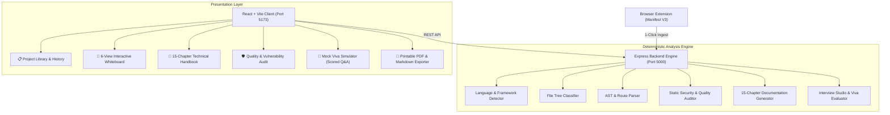

# Viva-Bachao (विवा बचाओ) 🎓📋
### GitHub Project Intelligence, Workflow Whiteboard & Interview Preparation Platform

> **"Turn any GitHub repository into a project you can understand, explain, improve, and defend during your viva and technical interviews."**

---

## 🌟 Overview

**Viva-Bachao** is a developer-learning and technical viva-defense platform engineered specifically for students, placement candidates, and software engineering applicants.

Students often build projects using tutorials, AI assistants, starter templates, or fragmented packages. When facing technical interviews or university viva examinations, candidates frequently struggle with questions like:
- *"How does your frontend request actually reach the database?"*
- *"Why did you choose this architecture over microservices or alternative patterns?"*
- *"What happens if this route handler throws an unhandled exception?"*
- *"What are the security flaws in your authentication or data storage pipeline?"*

**Viva-Bachao** bridges this gap by performing deterministic static code analysis on any public GitHub repository, extracting AST relationships, generating an interactive **pencil-sketch engineering whiteboard**, building an evidence-backed **15-chapter technical guide**, auditing code quality, and offering a **real-time Mock Viva Simulator**.

---

## 🎨 Design Philosophy: Paper & Pencil Sketch Whiteboard

The user interface is intentionally crafted to feel like an **authentic engineering paper notebook with hand-drawn pencil sketch borders**, featuring:
- **Cream Drafting Paper Background** with subtle dot-matrix engineering grid.
- **Organic Pencil Sketch Borders** (`sketch-box`) with graphite drop shadows.
- **In-Middle Structured Explanations** providing maximum technical clarity without distracting 3D gimmicks or flashy animations.
- **Straight Graphite Line Connectors** with clean direction arrows for technical flow diagrams.

---

## 🛠️ Architecture & System Blueprint



---

## 🚀 Key Modules & Features

### 1. 🧩 Browser Extension (Manifest V3)
- Installed in Chrome/Brave/Edge.
- Automatically detects when you are browsing a GitHub repository tab.
- 1-click trigger that dispatches an analysis job to the local Viva-Bachao engine.
- Direct shortcut to open the project in the web whiteboard.

### 2. 📐 Interactive Workflow Whiteboard
Explore the codebase through **6 dedicated engineering diagrams**:
1. **System Architecture**: Client UI -> API Gateway -> Controller -> Services -> Database.
2. **Request Lifecycle**: Click event -> Fetch dispatch -> Route middleware -> Controller response -> React state rerender.
3. **Data Lifecycle**: Raw user input -> Backend validation -> Sanitization -> Salt-and-hash -> Disk write & B-tree indexing.
4. **Auth & Security Flow**: Credential transmission -> Constant-time bcrypt hash check -> JWT minting -> Route guards.
5. **Error Recovery Flow**: Exception raised -> Global error middleware -> Masked error payload -> Client toast fallback.
6. **Deployment Flow**: Vite/TSC bundling -> Docker containerization -> Process manager runtime.

*Clicking any whiteboard node opens the **15-Parameter Component Inspector** detailing purpose, inputs, processing steps, outputs, plain-English vs. technical explanations, failure scenarios, and viva defense tips!*

### 3. 📖 15-Chapter Grounded Technical Guide
Generated strictly from inspected files with **Beginner 🟢**, **Intermediate 🟡**, and **Advanced 🔴** depth toggles:
- **Chapter 1:** Project Overview
- **Chapter 2:** Problem Being Solved (Inferred vs. Documented)
- **Chapter 3:** Feature Breakdown
- **Chapter 4:** Technology Stack
- **Chapter 5:** Folder Structure & Modules
- **Chapter 6:** Architecture
- **Chapter 7:** End-to-End Workflows
- **Chapter 8:** API Documentation
- **Chapter 9:** Database Design & Models
- **Chapter 10:** Important Implementation Details
- **Chapter 11:** Testing Strategy
- **Chapter 12:** Build and Deployment Pipeline
- **Chapter 13:** Strengths and Limitations
- **Chapter 14:** Improvement Roadmap
- **Chapter 15:** Interview Preparation Guide

### 4. 🛡️ Code Quality & Security Audit
- Heuristic detection of hardcoded secrets and unparameterized database queries.
- Modular maintainability checks and synchronous I/O event-loop warnings.
- **Before-and-After Code Diffs** providing actionable fixes for your project.

### 5. 🎯 Interview Studio & Mock Viva Rehearsal
- **Project Pitch Generator**:
  - ⏱️ 30-Second Elevator Pitch
  - ⏱️ 2-Minute Interview Overview
  - ⏱️ 5-Minute Technical Deep-Dive
  - 📝 Resume Action Bullet Points
- **9 Categorized Question Banks**:
  - Fundamentals, Tech Stack, Architecture, Code-Level, API & Database, Security, Testing & Debugging, Design Decisions, and Project Ownership.
- **Interactive Mock Viva Simulator**:
  - Type your answer to examiner questions.
  - Receives instant scoring (0-100), detailed feedback on what you explained well, what was missing, and a simulated examiner follow-up question!

### 6. 📄 Offline Report Exporter
- 1-click **Print to PDF** with high-resolution layout, cover page, table of contents, diagrams, and Q&A.
- Instant `.md` Markdown export for offline study notes.

---

## 💻 Quick Start & Installation

### Prerequisites
- [Node.js](https://nodejs.org/) v18+ (Node v24 recommended)
- [npm](https://www.npmjs.com/) v9+

### 1. Clone the Repository
```bash
git clone https://github.com/karthikeya1498/Viva-Bachao.git
cd "Viva-Bachao"
```

### 2. Install Dependencies
```bash
# Install server dependencies
cd server
npm install

# Install client dependencies
cd ../client
npm install
cd ..
```

### 3. Start the Application
Run both server and client in two terminals (or via npm scripts):

**Terminal 1 (Backend Analyzer Engine):**
```bash
cd server
npm run dev
# Server running at http://localhost:5000
```

**Terminal 2 (Web Whiteboard & Dashboard):**
```bash
cd client
npm run dev
# Client running at http://localhost:5173
```

Visit **`http://localhost:5173`** in your browser!

### 4. Load the Browser Extension in Chrome
1. Open Chrome and navigate to `chrome://extensions/`.
2. Enable **Developer mode** (toggle in the top-right corner).
3. Click **Load unpacked**.
4. Select the `extension/` folder inside this repository.
5. Navigate to any GitHub repository and click the **Viva-Bachao** extension icon to analyze with 1 click!

---

## 🔒 Free-First & Zero Cost Architecture

Viva-Bachao is built to run **100% locally with zero external API keys or paid dependencies**:
- **AST and Regex Code Analysis**: Executes entirely in Node.js without requiring external API calls.
- **Local Persistence**: Built-in atomic SQLite / file database layer in `server/data/`.
- **Zero Cost Target**: ₹0 budget architecture adhering strictly to Section 15 of the Product Master Report.

---

## 👨‍💻 Author & License

Created by **[Karthikeya](https://github.com/karthikeya1498)**  
Licensed under the [MIT License](LICENSE).
